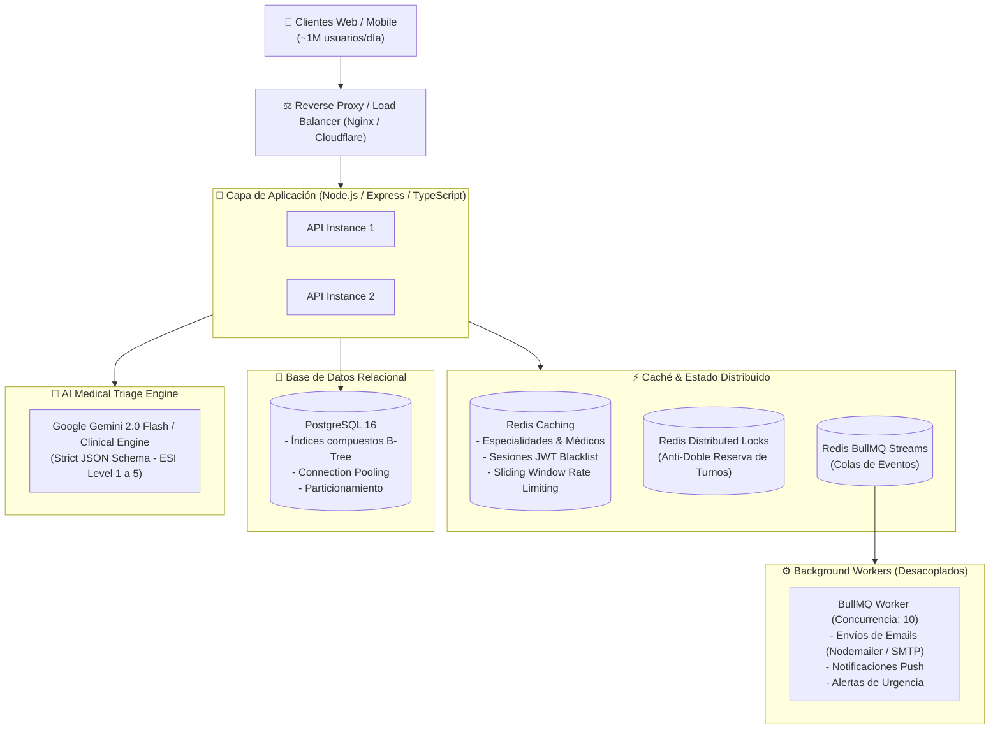

# 🏥 TurnoClínica Enterprise API & AI Medical Triage Engine

[](https://www.typescriptlang.org/)
[](https://nodejs.org/)
[](https://expressjs.com/)
[](https://www.postgresql.org/)
[](https://redis.io/)
[](https://bullmq.io/)
[](https://ai.google.dev/)
[](http://localhost:3001/api-docs)
[](https://www.docker.com/)

Plataforma backend de alto rendimiento diseñada para procesar **+1,000,000 de usuarios/día** (~15 millones de peticiones/día), con **bloqueos distribuidos contra condiciones de carrera (Race Conditions)**, **colas asíncronas con BullMQ**, y un **motor de Triaje Clínico Inteligente impulsado por IA** bajo el estándar médico internacional **ESI (Emergency Severity Index)**.

---

## 🏛️ Arquitectura del Sistema



---

## ⚡ Retos de Ingeniería y Soluciones Implementadas

### 1. Concurrencia Masiva y Prevención de Doble Reserva (Race Conditions)
- **Problema:** En horarios pico de alta demanda, cientos de pacientes intentan reservar el mismo cupo médico en el mismo milisegundo. En arquitecturas tradicionales, esto genera *overbooking* o bloqueos en cascada en la base de datos.
- **Solución:** Implementación del patrón **Bloqueo Distribuido (Distributed Mutex)** con Redis (`SET NX EX` con liberación atómica vía Lua Script) combinado con aislamiento de transacción `SERIALIZABLE` en PostgreSQL. Las reservas colisionadas se rechazan con `409 Conflict` en menos de 10ms, liberando la base de datos.

### 2. Procesamiento Asíncrono Desacoplado (BullMQ + Redis)
- **Problema:** El envío síncrono de correos electrónicos vía SMTP introduce una latencia de 1.5 a 4 segundos por petición HTTP, bloqueando el *Event Loop* y agotando las conexiones del servidor.
- **Solución:** Arquitectura orientada a eventos con **BullMQ**. Las peticiones HTTP encolan el trabajo en Redis en < 2ms y responden inmediatamente al cliente (`201 Created`). Los **Workers desacoplados** procesan los correos con reintentos automáticos, retroceso exponencial (*exponential backoff*) y aislamiento ante fallos.

### 3. Motor de Triaje Médico con Inteligencia Artificial (ESI 1-5)
- **Problema:** Los pacientes saturan las guardias hospitalarias con consultas no urgentes o postergan visitas críticas por falta de orientación.
- **Solución:** Endpoint `/triage/assess` integrado con **Google Gemini AI** que clasifica la severidad clínica del 1 al 5 (*Resuscitation, Emergent, Urgent, Semi-Urgent, Non-Urgent*):
  - **Niveles 1 y 2:** Dispara una alerta de emergencia inmediata vía BullMQ y recomienda derivación a guardia médica o ambulancia.
  - **Niveles 3 a 5:** Analiza la especialidad médica adecuada y puede **auto-agendar un turno** con el médico disponible de dicha especialidad (`autoSchedule: true`).

### 4. Seguridad de Nivel Empresarial y Validación
- **Autenticación:** JWT (JSON Web Tokens) con Access Token de vida corta + Refresh Tokens rotativos y lista de revocación en Redis.
- **Cifrado:** Contraseñas hasheadas con `bcrypt` (12 rondas de salt).
- **Validación en Runtime:** Esquemas de datos estrictos en tiempo de ejecución con **Zod**.
- **Manejo de Errores Estandarizado:** Respuestas de error bajo el estándar **RFC 7807** (*Problem Details for HTTP APIs*).
- **Protección Perimetral:** Headers de seguridad con `Helmet` y Rate Limiting por IP/usuario con `express-rate-limit` respaldado en Redis.

---

## 🚀 Puesta en Marcha Rápida (Docker Compose)

Levanta la infraestructura completa (PostgreSQL 16 + Redis 7 + API + Worker) con un solo comando:

```bash
docker compose up --build -d
```

Verificar estado de los contenedores:
```bash
docker compose ps
```

Acceder a la documentación interactiva Swagger:
```bash
http://localhost:3001/api-docs
```

Acceder al endpoint de salud:
```bash
curl http://localhost:3001/health
```

---

## 🛠️ Instalación y Desarrollo Local

### 1. Clonar el repositorio
```bash
git clone https://github.com/mauro8778/TurnoClinica-Back.git
cd TurnoClinica-Back/back
```

### 2. Configurar variables de entorno
```bash
cp .env.example .env
```

### 3. Instalar dependencias
```bash
npm install
```

### 4. Iniciar en modo desarrollo
```bash
npm start
```

### 5. Compilar para producción
```bash
npm run build
npm run start:prod
```

---

## 🧪 Prueba de Concurrencia y Resiliencia (Stress Test)

Se incluye un script automatizado que simula **30 peticiones concurrentes simultáneas** compitiendo por exactamente el mismo médico y horario:

```bash
npm run benchmark
```

**Resultado esperado:**
- 🟢 **1 turno reservado exitosamente (HTTP 201)**
- 🛡️ **29 intentos bloqueados por el Mutex Distribuido (HTTP 409)**
- ⏱️ **Tiempo de resolución:** < 150 ms sin colisión de datos en base de datos.

---

## 📡 Referencia de Endpoints Principales

### 🔐 Autenticación
| Método | Endpoint | Descripción | Body Requerido |
| :--- | :--- | :--- | :--- |
| `POST` | `/auth/register` | Registro de paciente con validación Zod | `name, email, birthdate, nDni, username, password` |
| `POST` | `/auth/login` | Login con verificación bcrypt y emisión JWT | `username, password` |
| `GET` | `/auth/me` | Obtiene el perfil del usuario autenticado | Header: `Authorization: Bearer <token>` |

### 📅 Turnos Médicos (Appointments)
| Método | Endpoint | Descripción | Headers / Params |
| :--- | :--- | :--- | :--- |
| `POST` | `/appointments/agendar` | Reserva atómica con bloqueo distribuido | `Bearer <token>`, `{ date, time, description, doctorId? }` |
| `GET` | `/appointments` | Listado paginado con filtros (`page, limit, date, status`) | Query params opcionales |
| `GET` | `/appointments/:id` | Detalle del turno con médico y triaje | Path param `:id` |
| `PUT` | `/appointments/cancelar/:id` | Cancelación de turno y notificación asíncrona | `Bearer <token>`, Path param `:id` |

### 🧠 Triaje Médico con Inteligencia Artificial
| Método | Endpoint | Descripción | Payload de Ejemplo |
| :--- | :--- | :--- | :--- |
| `POST` | `/triage/assess` | Clasificación ESI 1-5 + recomendación de especialista | Ver ejemplo abajo |
| `GET` | `/triage/history` | Historial de evaluaciones clínicas del paciente | `Bearer <token>` |

#### Ejemplo de Petición al Motor de Triaje:
```bash
curl -X POST http://localhost:3001/triage/assess \
  -H "Content-Type: application/json" \
  -H "Authorization: Bearer <TU_JWT_TOKEN>" \
  -d '{
    "symptoms": "Dolor punzante en la rodilla derecha luego de jugar al fútbol, no puedo apoyar el pie",
    "duration": "2 horas",
    "patientAge": 28,
    "autoSchedule": true
  }'
```

#### Respuesta Estructurada:
```json
{
  "status": "success",
  "data": {
    "assessment": {
      "id": 1,
      "urgencyLevel": 3,
      "category": "urgent",
      "recommendedSpecialty": "Traumatología",
      "rationale": "Traumatismo articular agudo con limitación funcional que requiere evaluación clínica y radiológica.",
      "redFlags": ["Imposibilidad de apoyo", "Aumento marcado de volumen articular"],
      "immediateActions": ["Reposo", "Crioterapia local", "Inmovilización"]
    },
    "isEmergency": false,
    "scheduledAppointment": {
      "id": 14,
      "date": "2026-11-06",
      "time": "10:00",
      "description": "Derivado por Triaje IA (Traumatología - Nivel 3)",
      "status": "confirmed"
    }
  }
}
```

---

## 👨‍💻 Autor

Desarrollado por **Mauro Diaz**  
- **GitHub:** [@mauro8778](https://github.com/mauro8778)
- **LinkedIn:** [Mauro Diaz](https://www.linkedin.com/)
